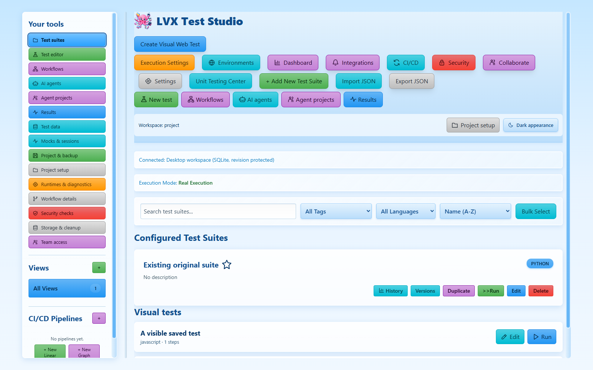
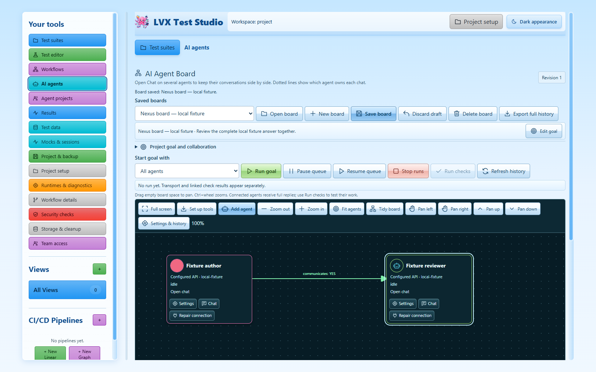
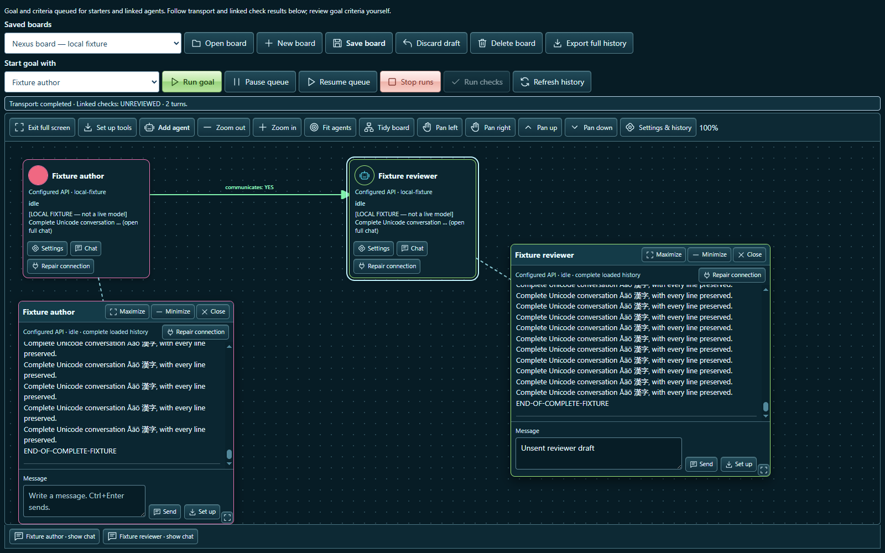
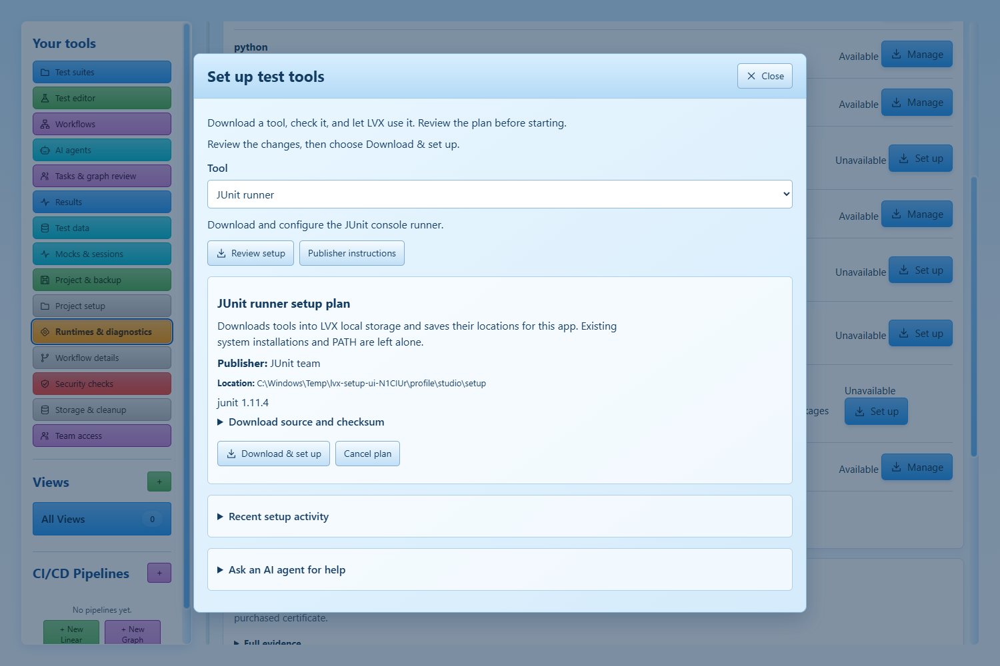

# LVX Test Studio

LVX Test Studio is a Windows app for testing websites and software. Choose test steps, connect tasks into a workflow, and see what passed or failed. AI agents can help with your project while you follow their conversations on a shared board.

## Open the app

Double-click **LVX Test Studio.exe** in the Windows app folder. This repository's local build is in `release\win-unpacked`. Keep the other files beside the app.

Choose a project folder to keep your work together. Only trust projects you recognise: tests and agents can run code on your computer.

To build the app from source, follow the [developer setup](docs/DEVELOPMENT.md#run-from-source).

## Make your first test

1. From **Test suites**, choose **New test**.
2. Give the test a name and choose what you want to test.
3. Add steps, such as opening a page, clicking a button or checking a value. Enter the result you expect.
4. Save the test, then choose **Run**.
5. Open **Results** to see the outcome. Select a failed step to read its error and available screenshots or output.

Return to saved tests from **Test suites**. Use **Test editor** to return to the test you left open. You can also edit code or use an existing test project.

## Test an existing website

Choose **Create Visual Web Test**, then choose where the website is:

- **Files or folder:** choose the project folder, or add several files. Add more later, update or remove individual files, and choose the HTML start page. **Reload Preview** applies your changes.
- **Git repository:** enter its URL and optional branch or tag, then choose **Get repository**.
- **Website address:** enter a staging or live URL, then choose **Use website**.

Folder loading keeps scripts, module imports, styles, images and nested pages together. **Read folder / repository again** picks up changes from the original source. Changes to the test's file list do not edit or delete your original files.

If the project needs its own server, LVX shows its package scripts. Review the script, choose whether to install dependencies, then select **Start project website**. Use **Stop project website** when finished, or **Stop all project websites** to stop servers started earlier. Projects using tools other than npm can be started outside LVX and tested through their URL.

Load the preview, add test steps, then choose **Run Live Test**. **Open interactive preview** opens the running website; the embedded view lets you pick elements. Save the test to run it again or use it in a workflow. See [website loading details](docs/WEB-TARGETS.md) for larger projects and saved folder connections.

## Connect tests in a workflow

Open **Workflows** to connect tasks. Place task boxes on the graph and draw connections to show what happens first. Select a box to configure it, then save and run.

For example, fetch a Git repository, run its tests and collect the results. Each box shows its own outcome.

## Work with AI agents

Open **AI agents** and add agents to the board. Choose each agent's provider, name and appearance in its settings. Open several chats, move or minimise them, or expand the board to full screen.

Choose **Add project folder** to put a folder on the board. Select an agent and choose **Work in folder**. The “works in” line shows that assignment. Native Codex, Claude Code and Gemini tools start in that folder; API chats do not have local file tools. Adding a folder keeps your board and chat storage in the current LVX workspace.

Connect agents to let them pass work to one another. Write a goal, choose who starts and run it. Read their messages and pause or stop the work.

For work with several steps, open **Tasks & graph review** on the board. Follow its guide to create a work plan, assign tasks and review results. It also lets an agent inspect a saved test workflow and suggest changes for you to preview. Ordinary chats do not need a work plan.

AI features need a working account. Choose installed Codex, Claude Code or Gemini tools, or configure an API provider. Sign in using the provider's own tool. Your plan's limits or charges still apply.

Each open chat has a dotted line to its agent. Use **Maximize**, **Minimize** or the chat tabs to manage several chats. If a provider fails, choose **Repair connection** beside that agent or chat. It checks the installed tool and offers sign-in or setup actions without resending your message.

Review suggested changes before applying them. Run your tests to check the result.

## Save and share your work

Use **Save** in the test or workflow you are editing. For an AI board, choose **Save board**, enter a name, then choose **Save as a new board** or **Overwrite an existing board**. Overwriting asks you to choose the board and confirm. New copies include agents, connections and layout; chat history stays with its original board.

**Project & backup** exports and imports project files. Include run files to carry screenshots and other results.

To open an exported project, choose **Import JSON** on the home screen and select its `.lvx.json` file. Choose a project folder if asked, review the file and destination, then select **Import validated project**. The same file also works in **Project & backup**. Older test-suite JSON files still work from the home button.

Passwords and API keys are not included in project exports. You may need to set them up again on another computer. Read imported tests before allowing them to run.

## When something does not run

Open **Runtimes & diagnostics**, then choose **Set up** beside a missing tool. Review the download and choose **Download & set up**. LVX downloads tools such as Python, Java and .NET, then checks them. You can cancel a download and return to its progress later.

You can also choose **Set up tools** on the AI board or **Set up** inside an agent chat. Ask your agent which tools you need, then use its suggested setup buttons. You review and start each download yourself. Jest and NUnit setup changes the project you selected; other tools stay in LVX's local storage. See [tool setup](docs/RUNTIME-SETUP.md) for details.

Scheduled tests run while the desktop app is open.

See the [developer guide](docs/DEVELOPMENT.md) and [support guide](docs/SUPPORT.md) for setup details. Report problems through the repository's issue tracker with your steps and the error. Remove private information from screenshots and logs.

Licensed under [MIT](LICENSE). Other included software keeps its [own licences](THIRD_PARTY_NOTICES.md).
