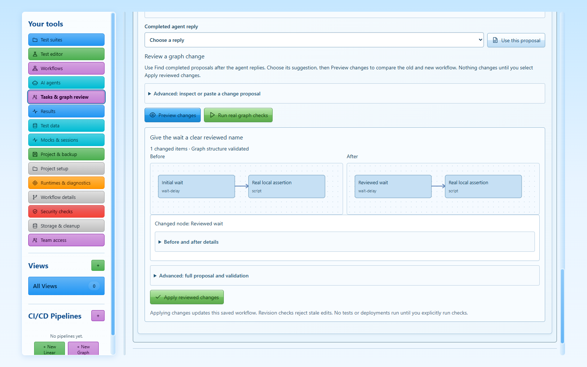
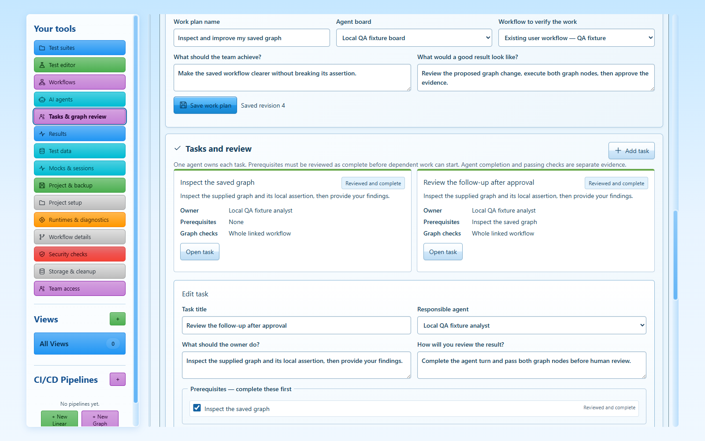

# Agent projects and visual workflow collaboration

Agent projects connects the agents you configured in **AI agent board** to the saved workflows in **Graph workflows**. It keeps the existing Machina nodes, configuration dialogs and execution engine. A new workspace still starts empty.

## Improve an existing graph

1. Open **Graph workflows**, build or open your graph, and choose **Work on this graph with agents**. Studio saves the current graph before opening the collaboration view. You can also open **Agent projects** directly and choose a saved workflow.
2. Choose **Load graph snapshot**. Inspect its nodes, connections, settings, dependencies and node catalog. Select particular nodes to focus the request, or leave the selection empty for the whole graph. Known credential settings and credential references are removed from shared context.
3. Choose your saved agent board and an agent. Describe the change. **Add graph-edit instructions** inserts a visible, editable proposal-format request; ordinary conversations do not require it. Choose **Send graph for analysis**.
4. **View agent conversation** opens the selected board. Back in Agent projects, choose **Find completed proposals**, select the completed reply and choose **Use this proposal**. You can also paste a proposal.
5. **Preview changes** shows before/after graphs and a readable list of changed nodes and connections. Expand the details for complete settings. Preview does not alter the saved graph or execute a test. **Apply reviewed changes** commits the saved workflow and its proposal receipt together. A changed graph revision invalidates an earlier proposal.
6. **Run real graph checks** executes the existing native workflow engine. A node selection includes its upstream dependencies. Nodes can perform their normal configured actions, including network calls and deployment review; inspect the graph before running it. **Stop running checks** cancels this check request. Results identify the native run and the graph revision they tested. **Open visual graph** returns to the actual editor with the applied changes.

## Give agents owned tasks

Create a project with a goal, acceptance criteria, a saved agent board and an optional verification workflow. Add tasks, assign one responsible agent to each, and select prerequisites. A prerequisite must be explicitly reviewed as complete before its dependent task can start. Cycles and conflicting active ownership are rejected.

**Start with owner** sends a visible task packet containing the project goal, task instructions, criteria and current graph context to that agent's existing native conversation or configured API conversation. **Open agent board** shows the actual linked board, including when you have several saved boards. Starting a task does not silently run every other agent or modify provider instructions.

When the agent finishes, choose **Collect result for review**. Studio checks the real completed provider run and executes the linked workflow or selected graph nodes. Passing checks are attached to the task with a revision and fingerprint. You can stop long-running collection checks. A provider refusal, output limit, interruption, test failure or stale graph cannot become a successful submission.

Read the findings and evidence, write a review comment and choose **Approve completed work** or **Request rework**. Human approval records semantic judgment; it is separate from provider completion and native test execution. Newer graph changes invalidate pending review evidence. Earlier approved work remains a historical record of the version that was reviewed.

## What was adopted from OpenRig

This implementation adopts the useful project/mission/task distinction, stable ownership, dependency ordering and evidence-based review described in the [pinned OpenRig research](research/openrig.md) and [video analysis](research/video.md). It independently implements those concepts within LVX's existing Windows architecture. It does not install OpenRig, provider hooks, shared-learning files, tmux or a distributed fleet.

Tasks, graph proposals and check receipts use the selected workspace's canonical SQLite records and normal project backup/archive path. Optimistic revisions preserve concurrent user edits. Restarted active tasks become visibly interrupted/blocked rather than replaying commands. Workspace switches drain/fence outstanding work.

## Verification boundaries

The automated user-flow suite runs actual Electron UI, native IPC, SQLite persistence, reviewed graph updates, JavaScript assertions and workflow execution. Its API responses are explicitly labelled local QA fixtures. `coordination-live-results.json` records a separate bounded installed-provider experiment and its exact source digest, actual outcome and account limitations. One successful model task does not establish general answer-quality parity or every account's availability.

The native app must find the official provider CLI and that CLI must be authenticated and usable in the selected project. Codex may require a Git project; Claude and Gemini retain their own login/project configuration requirements. LVX reports provider failures without changing native configuration or bypassing its policies. API conversations still do not automatically receive filesystem tools.

Current source, packaged build, full regression, screenshots and independent review receipts are stored in `docs/verification/coordination-*.json`. Older agent and node-dialog review receipts retain their original version/digest and do not certify a later release.
