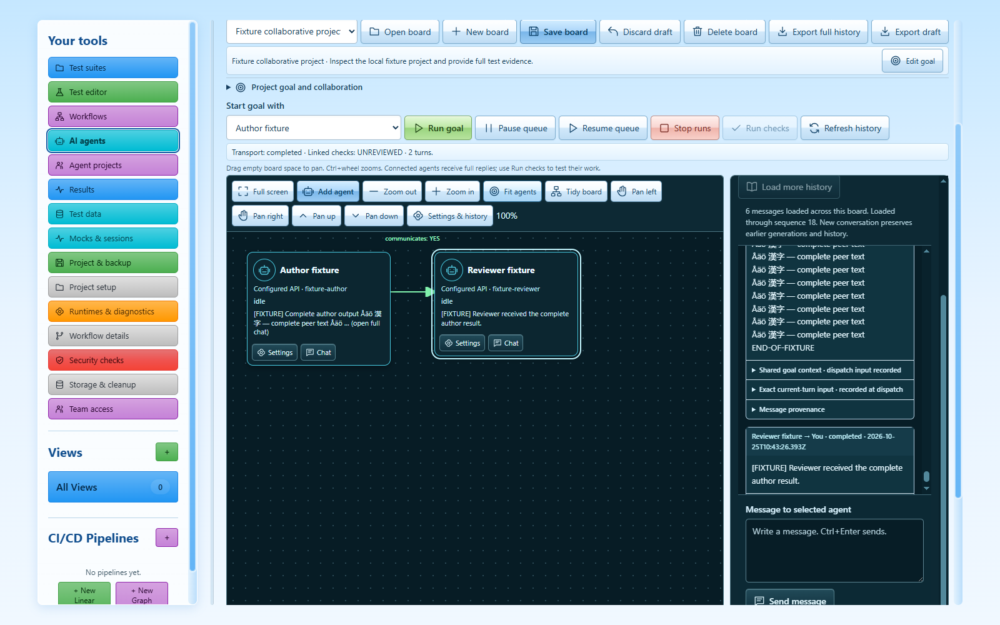

# Visual AI agent board

The board is a workspace view for people who want to arrange agents visually, give them a goal and inspect their actual conversations. It uses the same local project folder and transactional storage as the test studio. New projects contain no sample agents or conversations.

## Start a conversation

1. Choose and trust a project folder, then open **AI agent board**.
2. **Add agent**, give it a useful name and choose a provider. Native providers are installed Codex, Claude Code and Gemini CLIs; API providers require an explicit endpoint/model configuration.
3. Save the board. Select an agent on the canvas or in the keyboard controls, enter a message and send it.
4. Read its full chat, status, native conversation provenance and activity. A blocked login, permission request, limit or interrupted process appears as such. It never becomes a fabricated successful response.

The graph stays prominent. **Edit goal** and **Agent settings** reveal detailed configuration when needed. Drag nodes, pan and zoom, or use the keyboard list to select agents and create directed connections. Colour identifies providers while names and text statuses remain available without relying on colour alone.

## Native subscriptions and API accounts

Install the official provider CLI and complete its normal authentication outside LVX. **Check connection** checks the executable/version and reports the adapter's declared capabilities without sending a model prompt. Finding an installed program does not prove the account is signed in, entitled to a particular model or within quota. Native authentication, permission policy, account billing and provider terms remain those of that CLI.

Codex, Claude and Gemini use structured native output and their own conversation IDs. LVX resumes the recorded ID for the same agent generation. It never silently substitutes a new conversation after a resume failure. **New conversation** is an explicit action; old chats remain inspectable. Locally signed session provenance prevents an imported or edited archive from instructing a native CLI to resume an unverified foreign conversation.

Native CLIs run in the chosen project folder with their own tools. Configured API agents exchange conversation text; they do not automatically receive filesystem tools or the project's file contents. Choose a native CLI for direct project work, or supply the relevant context explicitly in an API conversation.

Leave native model and effort blank to preserve the CLI's configured defaults. Optional agent instructions are only the text you explicitly enter. Native permissions are exposed honestly; the board does not pass unrestricted/yolo flags or alter provider configuration files. Some requested permission modes are unsupported by a provider and are rejected rather than misrepresented.

API accounts are separate from consumer subscriptions. Configure an explicit model for standard APIs; a blank model for a custom server sends the literal `default` model alias. That endpoint must accept or map this alias; otherwise enter its explicit model name. Credential values are protected in the main process through Electron's available OS encryption backend. The saved board retains opaque references. Exported chats exclude credential values/references. Reconfigure credentials when moving to another computer. OpenAI-compatible, Anthropic and Gemini transports retain conversation roles and distinguish successful completion from refusal, output limits and missing completion metadata.

## Collaboration without hidden steering

Ordinary **Send** addresses only the selected agent, even if it has outgoing connections. It adds no automatic project-goal context; explicitly chosen agent instructions still apply. To collaborate, set a project goal, choose manual or linked mode, connect agents in the intended direction and press **Run goal**. The run snapshots the user-written goal and acceptance criteria. Selected starters and every linked recipient receive that saved context; **All agents** explicitly starts every visible agent. Editing the board later does not rewrite an existing run's context. Connections forward complete successful assistant output as peer messages, including sender and parent-message provenance. They do not replace it with a summary. In chat, expand the shared task context and exact current-turn input to inspect what was sent. The raw peer message remains separate and complete.

The board imposes turn/concurrency limits, queues deliveries per agent and waits for that agent to finish before delivering the next message. It does not send unsolicited role rules, demand a special JSON response, automatically steer a busy agent or change native model defaults. Explicit user instructions remain visible. Peer permission checks do not interrupt every ordinary handoff with an extra LVX approval dialog; native provider permissions still apply.

Use **Pause** to hold queued deliveries, **Resume** to continue admitted work and **Stop** to cancel the board's scoped processes. Already produced output remains readable as cancelled evidence and is not forwarded as a completed answer. After a timeout, malformed stream, refusal, limit or ambiguous interruption, queued continuations are fenced rather than blindly retried. Review effects and explicitly decide the next message. Restarted/imported queued work is marked interrupted and never automatically replayed.

API requests reconstruct complete eligible current-generation turns in completed, blocked, limit, partial and error states. Cancelled and interrupted deliveries remain fully visible/exportable but are deliberately excluded from later API model context: stopping uncertain work must not replay it as another prompt. Native CLI resume uses the provider's own session, which may retain partial context from before cancellation. Start a new conversation explicitly when you want a fresh context.

## Judge results using evidence

Write acceptance criteria beside the goal, choose a reviewer agent if useful, and link a saved native workflow when executable checks can establish the result. **Run checks** invokes the real workflow engine. A successful provider turn means its transport completed; it does not mean the goal is correct. **Linked checks: VERIFIED** means the configured workflow passed. Written criteria still need review, and a trivial workflow cannot substantiate unrelated requirements.

Inspect complete messages, native stdout/protocol/stderr, run states, parent deliveries and chronological events. Load earlier history or export the full stored history. Agent claims are not converted into verified test results. No orchestrator can guarantee better model answers: this implementation removes specific intrusive mechanisms found in the compared projects, but model quality must be judged on actual tasks.

## Save, restore and recover

Boards, positions, links, sessions, runs, messages and events belong to the selected workspace. Revision checks preserve unsaved edits when another window changes a board. A workspace switch cannot redirect an old view's message into the new project. Choose a fresh board or reload intentionally when a conflict appears.

Project archives use the existing checksummed SQLite archive path. Restore drains agent processes before replacing data. If this changes the project after preview, review a fresh import preview; the stale revision is not silently accepted. Imported executable boards require one-time review before new work. Restoring history refreshes the board from sequence zero, so older restored cursors cannot leave newer messages on screen. Dirty drafts remain available until an explicit discard/export decision. Imported native session identifiers are evidence, not permission to resume an unverified session.

## Verification and boundaries

Current evidence is recorded in `docs/verification/agent-*.json` alongside the full regression and source/packaged desktop receipts. Tests use explicitly named deterministic local fixtures, including long Unicode messages, real Electron IPC, canonical SQLite persistence and real linked workflow execution. Native process fixtures exercise CLI protocol parsing, session identity, cancellation, stale work and negative completion states. These are not live paid model calls and do not certify account authentication or comparative answer quality.

The external source analysis is indexed in [Research](research/README.md). The linked video's complete English transcript (0:00–24:47) was recovered through the browser exporter and analysed in the [video supplement](research/video.md). This is transcript analysis; a complete audiovisual inspection is not claimed. The earlier fleet report preserves the initial failed-fetch limitation. The separate independent review names its exact source digest; older 0.3.0 reviews are historical. Windows installers are currently unsigned, and hosted CI remains subject to the repository account's runner/billing availability.
