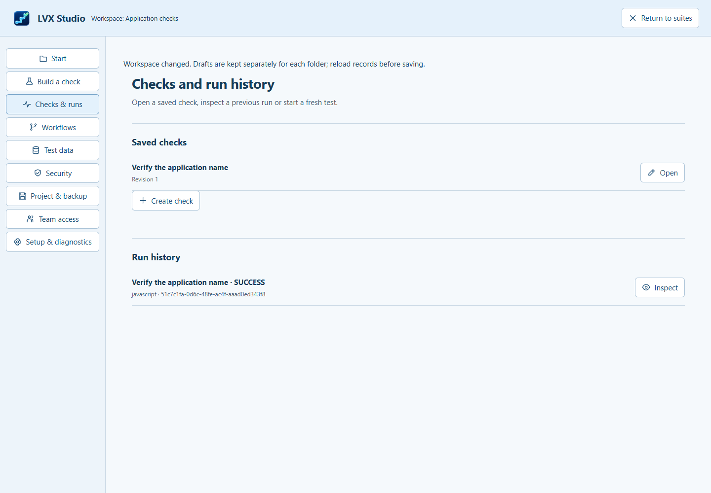

# Development and technical reference

The [main README](../README.md) explains how to use the Windows app. This guide covers source setup, execution tools, storage, security boundaries and verification. The public project is hosted at https://github.com/KZTP47/LVX-Test-Studio.

Some linked historical reports and guides describe earlier layouts. Check their date and source before using their screenshots, counts or reviewer verdicts for a later build.

See [GitHub file checks](GITHUB-HYGIENE.md) before committing. Generated reports, raw native captures, exports and private settings stay local; reviewed guide images are in `docs/images`. A fresh clone contains the tools and reference inputs, not earlier developers' saved test results.

## Run from source

Development target: Windows x64, Node.js 22.18+, npm and Python 3.10+. Java and .NET are optional prerequisites for their engines. Git is needed for repository operations.

```powershell
git clone https://github.com/KZTP47/LVX-Test-Studio.git "LVX Test Studio"
cd "LVX Test Studio"
npm ci
npm run setup
npm start
```

Setup installs pinned pure-Python extras into `.external/python-runtime-packages`, downloads pinned Chromium and prepares local editor/UI assets. It does not install Python packages globally. Set `LVX_PYTHON` to an installed Python executable when needed. Preparation needs networking; ordinary local runs use prepared resources.

For a static browser preview, run `npm run dev` and open [localhost:4173](http://127.0.0.1:4173). Filesystem access, native processes, encrypted credentials and transactional storage require Electron.

## Engines and prerequisites

| Engine | Execution |
|---|---|
| Visual value / HTTP checks | Generated JavaScript in a terminable Node child process; explicit assertions |
| Browser steps / Playwright | A child process controls bundled Chromium |
| Python / unittest | Installed Python; separate process and real discovery |
| pytest | Installed Python, pinned local extras and actual project discovery |
| Robot Framework | Installed Python, pinned extras and an authenticated driver controlling isolated Chromium |
| Java / C# | Installed JDK / .NET SDK; real compilation and execution |
| Jest | A selected project containing Jest and actual tests |
| JUnit | Java test project and an explicitly configured console JAR |
| NUnit | .NET test project with NUnit, test SDK and adapter dependencies |

**Setup & diagnostics** reports versions, missing prerequisites and available operations. JavaScript supports interactive V8 debugging; other engines expose their actual cancellation/output capabilities. Missing runners, discovery errors and zero-test projects cannot pass. Report-file project adapters reject protected secret parameters until those report transports can handle them safely.

The Windows package includes Electron, Node, Playwright, Chromium and pure-Python framework extras. Python, a JDK and .NET executables are detected on the user's computer.

## Workflows, data and evidence

Workflows validate their versioned graph before saving or running. Independent tests can run concurrently; resource locks protect shared targets. Typed inputs/outputs and explicit mappings retain producer/run provenance. Attempts, retries, failure policies and rerun relationships remain inspectable.

Dataset tools validate required fields, types and ranges, identify rows needing correction, generate repeatable synthetic records and create explicitly masked copies. Large CSV inputs are processed by the workspace service; previews show a limited sample.

SQLite transactions and record revisions protect workspace data. Two windows cannot silently overwrite a stale suite or check. Conflict controls retain drafts and offer review, reload or a separate copy. A suite update and its previous version commit together.



Project archives contain a versioned manifest, checksums, dependencies and optional binary evidence. Imports are validated before the canonical database transaction. Credential values are excluded; opaque references need suitable credentials on the destination computer. Imported executable content requires separate review. Restored schedules are disabled until explicitly enabled. Retained editor settings have an explicit snapshot/restore path.

Schedules run while the desktop execution service is open in that workspace. The missed-run policy skips missed work or executes once. The app does not install an always-running Windows service.

## Trust and credentials

The selected workspace scopes desktop file operations. Trust authorizes code execution; it is not an operating-system sandbox. Native tests can use their process permissions.

Credentials use Electron safeStorage and the available OS encryption backend. Configurations retain opaque references. The renderer does not receive decrypted values. Credential requests resolve in the main process with bounded responses, cancellation and redaction. Unavailable encryption fails visibly.

Uploaded website JavaScript runs without the desktop bridge in a separate browser environment. The picker uses a static snapshot; test actions use the isolated driver. Legacy inline previews deny networking unless an origin is explicitly allowed. Project and website targets retain normal HTTP(S)/WS(S) access, HTTP(S) navigation and the website's own CSP in a private sandboxed partition; file access, Node, desktop IPC, popups, downloads and device permissions remain unavailable. Website sign-in state is isolated by LVX workspace and origin for the app session. Screenshot baselines are scoped to the workspace and validated during archive operations. See [website targets](WEB-TARGETS.md) for discovery, explicit package startup and portable/source-bound saves.

Source rules and infrastructure adapters report findings, locations, fingerprints, coverage and errors. Supported lockfiles/SBOMs resolve dependencies to exact versions. Incomplete lookups cannot pass policy gates. These checks describe their scope; they do not prove arbitrary software secure. Remote infrastructure requires a genuine adapter and authorized target.

The authenticated loopback team service supports owner/editor/viewer roles, revocable identities and revision-protected edits. Remote exposure needs a separately administered secure deployment. Opening the app sends no notification.

## Headless CI

The repository ships an authenticated CLI/service and GitHub Actions, GitLab and Jenkins templates. Store tokens in the CI provider's secret store.

```powershell
# Supply LVX_CI_TOKEN and LVX_CI_AUTH_TOKEN securely through the CI environment.
node services/execution/cli.cjs run --workspace . --workflow lvx-workflow.json --data-dir test-results
```

Terminal JSON contains total, passed, failed, errors and pending counts. Failure, error, pending or zero tests produces a nonzero exit. The [Windows workflow](../.github/workflows/verify.yml) prepares toolchains and retains artifacts. A workflow file is not evidence that a hosted job ran.

## Build and verify

Full verification requires the installed Python, JDK and .NET toolchains used by the native framework fixtures. Prepare test-only packages locally, then run these public-checkout commands:

```powershell
python -m pip install --target .external/python-test-packages --requirement tests/requirements.txt
node services/execution/prepare-native-fixtures.cjs
npm test
npm run test:e2e
npm run test:roadmap
npm run test:machina
npm run test:agent-style
npm run test:agent-board
npm run build:desktop
npm run verify:desktop
```

For a focused agent check, use `npm run test:agents`.

Some older delivery, provenance and review scripts refer to commit IDs or review receipts from the separate private archive. They are retained as historical engineering records and are not part of this public build checklist. Do not import private Git history to make those old checks pass; use the commands above for the current public project.

Desktop verification compares packaged source hashes and runs the actual application outside the repository. Installer verification refuses to modify an existing LVX installation, uses a temporary fixture, checks upgrade/reinstall and launch, then uninstalls it. `node scripts/clean-room.cjs` repeats setup and verification in a clean directory.

Project/graph checks are described in [the project guide](AGENT-PROJECTS.md), and board checks in [the agent guide](AGENT-STUDIO.md). Generated reports live locally in [verification](verification). Run checks to generate them after cloning. Independent review requires a new review of the actual candidate. Historical approval does not approve later source changes. Check source digests and dates before reusing counts. The [original repairs](verification/REPAIRS.md) and [implementation outcomes](roadmap/README.md) remain shared reference documentation.

Local installers are unsigned. The protected [release workflow](../.github/workflows/release.yml) requires a publisher identity and checks Authenticode before producing a signed candidate. No certificate has been supplied or purchased automatically; no public update feed is enabled. The update policy verifies signatures, hashes, expiry, release sequence and explicit rollback approval.

## Contributing and support

Read [CONTRIBUTING.md](../CONTRIBUTING.md), [SECURITY.md](../SECURITY.md), the [support matrix](SUPPORT.md) and [CHANGELOG.md](../CHANGELOG.md). Reports should include a minimal authorized fixture and redacted evidence. macOS/Linux distributions are not certified by the Windows evidence.

Services and the visual compiler use explicit module contracts. The retained editor exposes a compatibility facade for existing inline handlers; its dependencies are declared and validated by the UI build. The versioned [extension contract](api/studio.d.ts) grants specific operations. Extension implementations are trusted application code, not a sandbox.

Original code is licensed under [MIT](../LICENSE). Third-party components retain their licenses; see [THIRD_PARTY_NOTICES.md](../THIRD_PARTY_NOTICES.md).

## AI agents and projects

The board supports installed Codex, Claude Code and Gemini tools and explicitly configured API providers. Installed CLI detection does not confirm account access. Account login, provider configuration, subscriptions and billing remain with the provider. Inspect a verification report's stated scope before treating fixture responses as evidence of live model calls.

The board retains native session identities and peer messages. It shares the saved goal and criteria with participants, and exposes input sent for each turn. Manual conversations, directed collaboration and linked test runs have separate controls. For task ownership, review, graph context and proposed edits, see [Agent projects](AGENT-PROJECTS.md). The [agent guide](AGENT-STUDIO.md) covers provider setup.

## Windows app build

```powershell
npm run build:desktop
```

This prepares assets and creates the unpacked Windows app in `release/win-unpacked`. `npm run dist` also creates an installer. Close the app before replacing its executable or packaged files, and preserve existing user data.

## Mascot assets

The master at `assets/icons/lvx-test-studio.png` is the user's original transparent PNG. Regenerate Windows sizes and the multi-resolution icon without changing the artwork:

```powershell
node scripts/mascot-assets.cjs
node scripts/verify-mascot.cjs
```

The verifier checks the original file hash, decoded resized pixels, alpha channels and actual ICO entries. It also rejects deliberately corrupt copies. The normal asset build uses the same seven resolutions.

The historical Machina source is preserved in `apps/lvx-machina`; the maintained app is at the repository root. See [Machina migration](MACHINA-MIGRATION.md) and [source research](research/README.md).

## Current interface checks (0.6.0)

These scripts use disposable Electron profiles and project folders. The board script uses a labelled localhost response fixture and makes no paid model calls.

```powershell
node scripts/unified-ui-e2e.cjs source
node scripts/agent-board-nexus-e2e.cjs
npm test
node scripts/unified-ui-e2e.cjs packaged
node scripts/agent-board-nexus-e2e.cjs --packaged
node scripts/verify-pe-icon.cjs
node scripts/verify-unified-review.cjs
```

The packaged checks use `release/win-unpacked`. Each report binds its runtime source digest and test-script hash; packaged reports also identify the ASAR and executable. The PE icon verifier checks all seven embedded Windows icon frames against the mascot ICO. Independent review receipts stay local under `docs/verification`. They must be produced by an independent reviewer for the candidate being checked, not reused as approvals after cloning.
